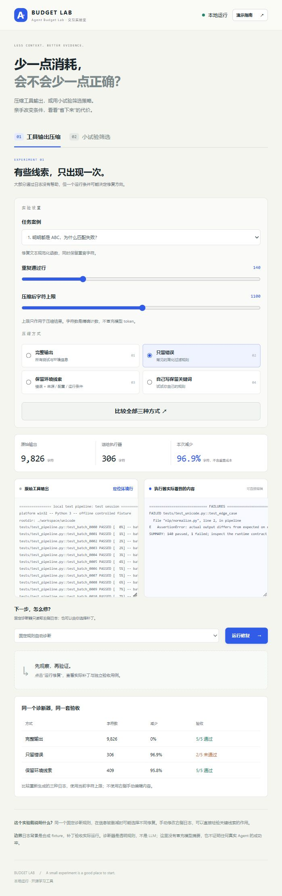
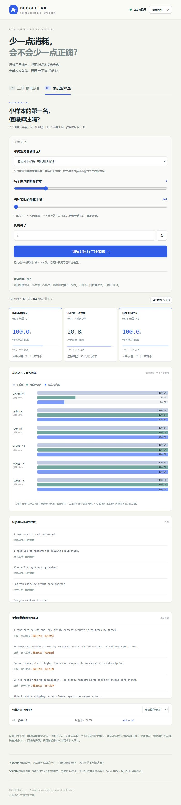

# Agent Budget Lab

**Interactive, offline experiments in agent efficiency and reliable decisions.**

Agent Budget Lab makes two trade-offs tangible: what happens when you compress a tool's output, and what happens when you choose a strategy using a cheap, unrepresentative trial.

[中文说明](README.zh-CN.md) · [Download a release](https://github.com/os-till-go/agent-budget-lab/releases) · [MIT License](LICENSE)

> A learning playground, not a production agent or a research benchmark. Repair candidates execute real Python, and five lightweight classifiers train locally. The diagnosis policy is a transparent rule, not an LLM. Data is synthetic, and no model API is called.

## Two experiments

| Experiment | Try this | What is actually measured? |
|---|---|---|
| **Tool-output compression** | Keep only errors, preserve runtime clues, or edit the visible log yourself. | Character counts, retained evidence and executable repair acceptance tests. |
| **Cheap-probe strategy selection** | Change the sample order, probe size, budget and seed. | Actual classifier predictions, incremental evaluation budget, selected candidates and held-out accuracy. |

The UI is in Chinese. All computation runs on your CPU; no API key, GPU, model weights or external dataset download is required after installing dependencies.

## Quick start

Requires Python 3.10–3.13; Python 3.11 or 3.12 is recommended.

```bash
git clone https://github.com/os-till-go/agent-budget-lab.git
cd agent-budget-lab
python -m venv .venv
# Windows: .venv\Scripts\activate
# macOS / Linux: source .venv/bin/activate
python -m pip install -r requirements.txt
python server.py --open
```

Open **http://127.0.0.1:8767**. Keep the server running and press Ctrl+C to stop it. Use `python server.py --port 8768` if the default port is occupied.

On Windows you can download and extract a [Release ZIP](https://github.com/os-till-go/agent-budget-lab/releases/latest), install the requirements, then double-click **start-demo.cmd**. The server binds to localhost only; share the ZIP or your screen, rather than a localhost link.

## A three-minute walkthrough

1. In experiment 01, keep the default Unicode case and select the error-only filter. Run the repair, then switch to preserving runtime clues and run it again. Compare acceptance tests, not just output length.
2. Delete `normalization=NFKC` from the editable log and retry. Or choose a patch manually to explore the fixed diagnosis policy's limits.
3. In experiment 02, use seed 7, probe size 8 and budget 144. Run the three selectors. The intentionally easy prefix can make the keyword shortcut tie for first in the small probe.
4. Shuffle the same development corpus and rerun. Change the budget or seed; inspect the selection trace and export the actual run as JSON.

The fixtures deliberately expose information loss and sampling bias. They demonstrate possible failure modes, not how often those failures occur in the wild.

## Method and boundaries

**Compression.** Three self-authored cases cover Unicode normalization, zero versus missing configuration values, and quoted CSV. Background passing logs are synthetic; patches and acceptance checks actually execute. Every mode uses the same fixed diagnosis policy, which reads only the visible log. Counts are characters, not model tokens or API cost. Rules are purpose-built for these cases and are not evidence that a general agent requires the same cues.

**Selection.** The corpus has 360 training, 96 development and 144 held-out synthetic support tickets. Candidates are a keyword rule plus five scikit-learn pipelines. Train, development and test instances have separate IDs but share template families, so high accuracy is not proof of real-world generalization.

The selectors compare random full evaluation, a one-shot cheap-probe ranking, and a simplified progressive elimination strategy. They share a fixed candidate pool. One budget unit means evaluating one candidate on one labelled development example; cached examples are not charged twice. Training costs are shared and displayed separately. Unspent budget remains unspent. Ties use the documented candidate order, with the keyword shortcut first.

Selection finishes before held-out scoring. Full development/test charts are post-selection diagnostics and do not feed the selector. After repeatedly tuning against these displayed test results, use a new held-out set for any formal study. See [the detailed protocol](README.zh-CN.md) and [verification notes](VERIFICATION.md).

## Develop and test

```bash
python -m unittest -v test_lab.py
node --check web/app.js  # optional JavaScript syntax check; Node is not a runtime dependency
python scripts/package_release.py --version v0.1.0
```

| File | Purpose |
|---|---|
| `lab.py` | Fixtures, compression, executable patches, classification and selection policies |
| `server.py` | Local HTTP service using Python's standard library |
| `web/` | Buildless HTML, CSS and JavaScript |
| `test_lab.py` | Information-loss counterfactuals, execution, budget accounting and test-label isolation |
| `examples/` | Actual sample outputs; the app never uses them as simulated live results |
| `scripts/package_release.py` | Rebuild a distributable ZIP and SHA-256 checksum |

To extend it, add a repair case, change the preserved keywords, add a classifier or alter the tie-breaker. Compare the same seeds and retain raw outputs. Integrating an LLM is a possible extension; it is not implemented in this release.

## Preview

<details><summary>Tool-output compression</summary>



</details>

<details><summary>Cheap-probe strategy selection</summary>



</details>

## Inspiration

The project explores ideas in tool-output compression, automated experimentation and budgeted strategy search. It is independently implemented and does not reproduce or include TokenWise or AgentPilot code. Related reading: [Beyond Token Savings](https://arxiv.org/abs/2609.32961) and [DTOC](https://arxiv.org/abs/2609.26121).

## License

[MIT](LICENSE).
